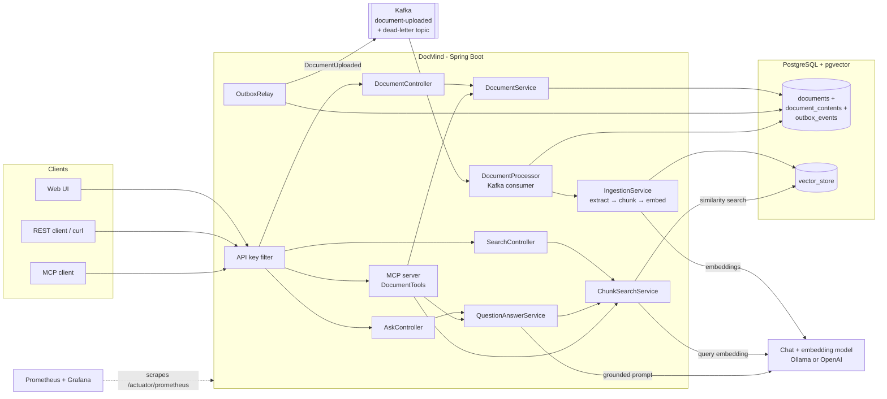
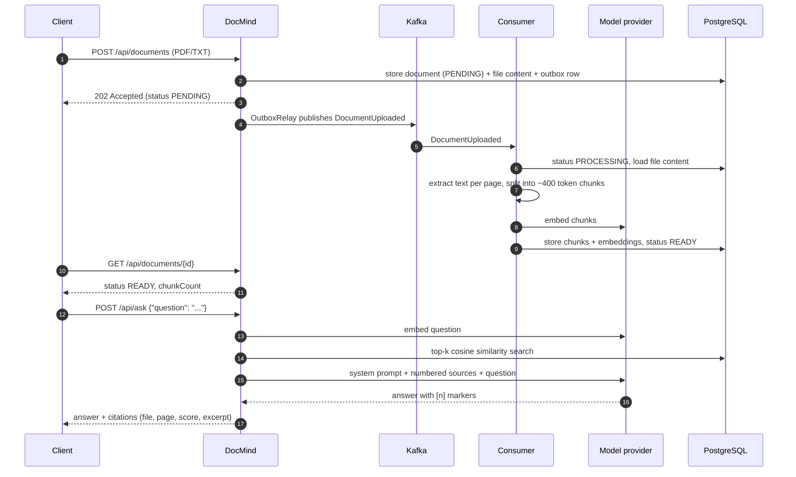

# DocMind AI

[](https://github.com/nakhat-parveen/docmind-ai/actions/workflows/ci.yml)


DocMind is a document Q&A service. Upload PDF or text files and ask questions about them. Every
answer comes with numbered citations that point back to the exact chunk, file and page it was taken
from.

It is a Retrieval-Augmented Generation (RAG) backend built with Spring Boot and Spring AI, using
PostgreSQL with pgvector as the vector store. Models are pluggable: run fully local with Ollama or
use OpenAI. The same search and Q&A features are also exposed as an MCP server, so MCP-capable
tools and agents can query your documents directly.

## Features

- **Upload PDF and TXT** files. Text is extracted page by page, split into token-based chunks and embedded
- **Background processing with Kafka**: uploads return right away; a transactional outbox publishes the event, a consumer indexes with retries and a dead-letter topic
- **Semantic search** over all chunks, optionally restricted to selected documents
- **Q&A with citations**: answers are grounded in the retrieved chunks and reference them as `[1]`, `[2]`, …
- **Document management** REST API with pagination, status/name filters, duplicate detection (SHA-256) and failure tracking
- **MCP server** (Streamable HTTP) with `search_documents`, `ask_documents` and `list_documents` tools
- **API key authentication** for REST and MCP endpoints, with RFC 9457 problem details for all errors
- **OpenAPI / Swagger UI** with documented success and error responses
- **Rate limit** on `/api/ask` (token bucket per API key)
- **Small web UI** for uploading, browsing and asking questions, with live processing status
- **Monitoring**: Prometheus metrics, a provisioned Grafana dashboard and correlation ids in every log line
- **Provider profiles**: `ollama` (default, local) and `openai`
- **Flyway** migrations, **Testcontainers** integration tests, **Docker** image and **GitHub Actions** CI

## Architecture



### Ingestion and question flow



### Code layout

The code is organised by feature, each package containing its controller, service and DTOs:

```
com.docmind
├── document    REST API, entities and repositories for uploaded documents
├── outbox      transactional outbox table and scheduled Kafka relay
├── processing  Kafka topics, producer, consumer, retries and processing metrics
├── ingestion   text extraction, chunking, writing to the vector store
├── retrieval   similarity search and the /api/search endpoint
├── qa          prompt building, answer + citation handling, /api/ask
├── ratelimit   per-API-key token bucket on /api/ask
├── mcp         MCP tool definitions
├── security    API key filter and Spring Security setup
├── logging     correlation id filter and Kafka record interceptor
├── config      OpenAPI configuration
└── web         global exception handling
```

## Getting started

### Prerequisites

- Java 21
- Docker (for PostgreSQL, Kafka, Ollama and the tests)

### Run locally with Ollama

```bash
# PostgreSQL with pgvector, Kafka and Ollama
docker compose --profile ollama up -d

# start the app (the ollama profile is the default)
./mvnw spring-boot:run
```

On first start the app pulls the configured models (`llama3.2` and `nomic-embed-text`), which can
take a few minutes. Then open <http://localhost:8080> and enter the API key `local-dev-key`.

### Run with OpenAI

```bash
docker compose up -d postgres kafka
export OPENAI_API_KEY=sk-...
./mvnw spring-boot:run -Dspring-boot.run.profiles=openai
```

> **Note:** The size of the embedding column depends on the model (768 for `nomic-embed-text`,
> 1536 for `text-embedding-3-small`) and is fixed by the first Flyway migration. Use a separate
> database when switching providers, e.g. `docker compose down -v` to start from scratch.

### Run everything in Docker

```bash
cp .env.example .env    # set DOCMIND_API_KEYS and the provider
docker compose --profile app up -d --build
```

This starts the app together with PostgreSQL, Kafka, Ollama, Prometheus and Grafana. In this
setup the app writes JSON log lines (Elastic Common Schema), ready for a log collector.

### Configuration

| Variable                 | Default                                   | Description                          |
|--------------------------|-------------------------------------------|--------------------------------------|
| `SPRING_PROFILES_ACTIVE` | `ollama`                                  | `ollama` or `openai`                 |
| `DOCMIND_API_KEYS`       | `local-dev-key`                           | Comma separated list of API keys     |
| `DB_URL`                 | `jdbc:postgresql://localhost:5432/docmind` | JDBC URL                             |
| `DB_USERNAME` / `DB_PASSWORD` | `docmind` / `docmind`                | Database credentials                 |
| `OLLAMA_BASE_URL`        | `http://localhost:11434`                  | Ollama endpoint                      |
| `OLLAMA_CHAT_MODEL`      | `llama3.2`                                | Ollama chat model                    |
| `OLLAMA_EMBEDDING_MODEL` | `nomic-embed-text`                        | Ollama embedding model (768 dims)    |
| `OPENAI_API_KEY`         | –                                         | Required for the `openai` profile    |
| `OPENAI_CHAT_MODEL`      | `gpt-4o-mini`                             | OpenAI chat model                    |
| `KAFKA_BOOTSTRAP_SERVERS` | `localhost:9092`                         | Kafka broker address                 |
| `GRAFANA_ADMIN_PASSWORD` | `admin`                                   | Password of the Grafana `admin` user |

Chunking, retrieval, retries, the outbox relay and the ask rate limit can be tuned under
`docmind.ingestion.*`, `docmind.retrieval.*`, `docmind.processing.*`, `docmind.outbox.*` and
`docmind.rate-limit.*` in `application.yml`.

## Usage

All `/api/**` and `/mcp` requests need the `X-API-Key` header.

```bash
export KEY=local-dev-key

# upload (returns 202 Accepted with status PENDING)
curl -H "X-API-Key: $KEY" -F file=@handbook.pdf http://localhost:8080/api/documents

# check the status until it is READY (or FAILED, with an errorMessage)
curl -H "X-API-Key: $KEY" http://localhost:8080/api/documents/<id>

# list (optional status, name, page, size, sort)
curl -H "X-API-Key: $KEY" \
     "http://localhost:8080/api/documents?status=READY&name=hand&page=0&size=20&sort=createdAt,desc"

# semantic search
curl -H "X-API-Key: $KEY" -H "Content-Type: application/json" \
     -d '{"query": "remote work policy", "topK": 3}' \
     http://localhost:8080/api/search

# ask
curl -H "X-API-Key: $KEY" -H "Content-Type: application/json" \
     -d '{"question": "How many vacation days do new employees get?"}' \
     http://localhost:8080/api/ask
```

Example answer:

```json
{
  "answer": "Full-time employees get 30 days of paid vacation per year [1]. New employees can take it after the three month probation period [1].",
  "citations": [
    {
      "number": 1,
      "documentId": "62ceb6eb-2c7d-4a5d-ace8-c152da17e217",
      "filename": "handbook.pdf",
      "page": 2,
      "chunkIndex": 3,
      "score": 0.66,
      "excerpt": "Vacation: Every full-time employee is entitled to 30 days of paid vacation per calendar year…"
    }
  ]
}
```

Errors are returned as problem details:

```json
{
  "type": "about:blank",
  "title": "Duplicate document",
  "status": 409,
  "detail": "The same file was already uploaded as document 62ceb6eb-2c7d-4a5d-ace8-c152da17e217",
  "existingDocumentId": "62ceb6eb-2c7d-4a5d-ace8-c152da17e217"
}
```

### REST API

| Method   | Path                    | Description                                   |
|----------|-------------------------|-----------------------------------------------|
| `POST`   | `/api/documents`        | Upload a PDF/TXT file (multipart, field `file`), processed in the background |
| `GET`    | `/api/documents`        | List documents (paged; `status`, `name`, `sort`) |
| `GET`    | `/api/documents/{id}`   | Get document details and processing status    |
| `DELETE` | `/api/documents/{id}`   | Delete a document and its chunks              |
| `POST`   | `/api/search`           | Semantic search over chunks                   |
| `POST`   | `/api/ask`              | Ask a question, get an answer with citations (rate limited per API key) |

Interactive docs: <http://localhost:8080/swagger-ui.html> (OpenAPI JSON at `/v3/api-docs`). Error
responses are documented as RFC 9457 problem details.

### MCP server

DocMind exposes an MCP server over Streamable HTTP at `http://localhost:8080/mcp`.

| Tool               | Arguments                | Returns                              |
|--------------------|--------------------------|--------------------------------------|
| `search_documents` | `query`, `topK` (opt.)   | matching chunks with score and source |
| `ask_documents`    | `question`               | answer with citations                |
| `list_documents`   | –                        | uploaded documents                   |

Try it with the MCP Inspector:

```bash
npx @modelcontextprotocol/inspector
# Transport: Streamable HTTP, URL: http://localhost:8080/mcp
# add header X-API-Key: local-dev-key
```

Most MCP clients that support remote servers accept a configuration like this:

```json
{
  "mcpServers": {
    "docmind": {
      "url": "http://localhost:8080/mcp",
      "headers": { "X-API-Key": "local-dev-key" }
    }
  }
}
```

## Document processing

Uploading and indexing are separate steps:

1. `POST /api/documents` checks the file type and duplicates, then stores the document (`PENDING`),
   the file content and an outbox row in **one database transaction**, and answers `202 Accepted`.
   Kafka being down does not fail the upload.
2. A scheduled relay (`OutboxRelay`) reads unsent rows (`FOR UPDATE SKIP LOCKED`), publishes a
   `DocumentUploaded` event to `docmind.document-uploaded` and marks the row sent. The document id
   is the message key, so events for the same document stay in order. If Kafka is down the row stays
   unsent and is tried again on the next run.
3. A Kafka consumer sets the status to `PROCESSING`, extracts, chunks and embeds the file and sets
   it to `READY`.
4. If that fails, the message is retried (3 attempts, 2 seconds apart by default). Errors that
   retrying cannot fix, such as a corrupt PDF, are not retried. When it gives up, the document is
   set to `FAILED` with the error message and the event is copied to `docmind.document-uploaded.dlt`
   for later inspection.

Processing is safe to repeat: old chunks of the document are removed before new ones are written,
and documents that are already `READY` or deleted are skipped. The web UI refreshes the list until
all documents are done.

## Monitoring

| Service    | URL                                        | Notes                          |
|------------|--------------------------------------------|--------------------------------|
| Metrics    | <http://localhost:8080/actuator/prometheus> | Prometheus format, no API key  |
| Prometheus | <http://localhost:9090>                     | scrapes the app every 15 s     |
| Grafana    | <http://localhost:3000>                     | user `admin`, dashboard "DocMind" |

Start Prometheus and Grafana on their own with `docker compose --profile monitoring up -d`, or
together with everything else using the `app` profile. The dashboard is provisioned from
`monitoring/grafana/dashboards/docmind.json`.

Custom metrics:

| Metric                                      | Type    | Meaning                                         |
|---------------------------------------------|---------|-------------------------------------------------|
| `docmind_documents_processed_total`         | counter | finished documents, tag `outcome` = `ready` / `failed` |
| `docmind_documents_processing_duration_seconds` | timer | time of one processing attempt                 |
| `docmind_kafka_listener_errors_total`       | counter | failed processing attempts, tag `exception`     |
| `docmind_outbox_pending`                    | gauge   | upload events stored but not yet sent to Kafka  |
| `docmind_answer_duration_seconds`           | timer   | time to answer a question, tag `sources` = `found` / `none` |

Kafka client metrics such as `kafka_consumer_fetch_manager_records_lag_max` (messages waiting to be
processed), HTTP, JVM and connection pool metrics come from Spring Boot and Micrometer.

Every request gets a correlation id. It is taken from the `X-Correlation-Id` request header or
generated, returned in the response, added to every log line and passed on as a Kafka header, so
the log lines of an upload and of its background processing can be found with one search.

## Testing

```bash
./mvnw verify
```

Docker must be running. Integration tests start `pgvector/pgvector:pg16` and Kafka containers
through Testcontainers and use a deterministic in-memory embedding model and a stub chat model, so no
model provider or API key is needed. The suite covers:

- unit tests for type detection, text extraction, chunking, prompt building and citation handling
- repository tests against the real schema created by Flyway
- end-to-end API tests for upload, list filters, search, ask, validation and error responses
- Kafka tests for background processing, retries, the dead-letter topic and uploads while Kafka is down
- metrics, correlation id and rate-limit tests
- security tests for protected and public endpoints
- an MCP test that connects a real MCP client to the running server
- context tests for the `ollama` and `openai` profiles

## Design notes

- **pgvector instead of a dedicated vector database**: one PostgreSQL instance holds both the
  document metadata and the embeddings, so there is a single thing to run, back up and secure.
  HNSW with cosine distance is fast enough for this scale.
- **Schema owned by Flyway**: the Spring AI `PgVectorStore` schema initialisation is turned off.
  The vector dimension is injected as a Flyway placeholder per profile.
- **Chunking**: token-based chunks of about 400 tokens. PDFs are read one page per document first,
  so every chunk keeps its page number for citations.
- **Grounded prompt**: retrieved chunks are numbered in the prompt and the model is told to answer
  only from them and cite `[n]`. If nothing relevant is found, the model is not called at all.
- **Ingestion runs in the background** through Kafka, so slow embedding calls never block an
  upload request. The event is written to an outbox table in the same transaction as the document
  and published afterwards, so an upload is kept even when Kafka is unreachable. The event carries
  only the document id; the file itself stays in PostgreSQL because Kafka messages are limited to
  about 1 MB by default.
- **Optimistic locking** (`@Version`) on documents: if a document is deleted while it is being
  processed, the late status update fails instead of bringing the row back.
- **API keys** are compared in constant time. The API is stateless, so CSRF protection is disabled.
- **Ask rate limit** is a token bucket in this process, keyed by API key. It protects the chat
  model from a noisy client; it is not a cluster-wide quota.

## Roadmap

- Hybrid search (full-text + vector) and re-ranking
- Streaming answers via Server-Sent Events
- Per-user document collections with JWT authentication
- Cluster-wide rate limiting (Redis) if more than one app instance is used

## License

[MIT](LICENSE)
