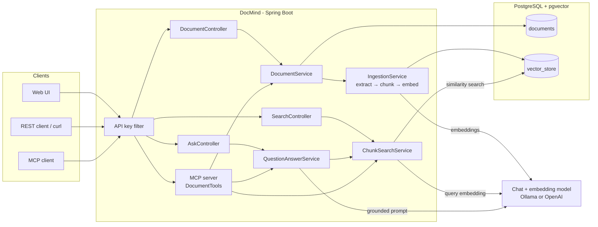
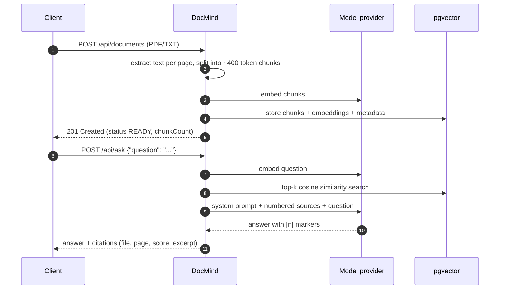

# DocMind AI

[](https://github.com/nakhat-parveen/docmind-ai/actions/workflows/ci.yml)


DocMind is a document Q&A service. Upload PDF or text files and ask questions about them. Every
answer comes with numbered citations that point back to the exact chunk, file and page it was taken
from.

It is a Retrieval-Augmented Generation (RAG) backend built with Spring Boot and Spring AI, using
PostgreSQL with pgvector as the vector store. Models are pluggable: run fully local with Ollama or
use OpenAI. The same search and Q&A features are also exposed as an MCP server, so MCP-capable
tools and agents can query your documents directly.

## Features

- **Upload PDF and TXT** files. Text is extracted page by page, split into token-based chunks and embedded
- **Semantic search** over all chunks, optionally restricted to selected documents
- **Q&A with citations**: answers are grounded in the retrieved chunks and reference them as `[1]`, `[2]`, …
- **Document management** REST API with pagination, duplicate detection (SHA-256) and failure tracking
- **MCP server** (Streamable HTTP) with `search_documents`, `ask_documents` and `list_documents` tools
- **API key authentication** for REST and MCP endpoints, with RFC 9457 problem details for all errors
- **OpenAPI / Swagger UI** documentation
- **Small web UI** for uploading, browsing and asking questions
- **Provider profiles**: `ollama` (default, local) and `openai`
- **Flyway** migrations, **Testcontainers** integration tests, **Docker** image and **GitHub Actions** CI

## Architecture



### Ingestion and question flow



### Code layout

The code is organised by feature, each package containing its controller, service and DTOs:

```
com.docmind
├── document    REST API, entity and repository for uploaded documents
├── ingestion   text extraction, chunking, writing to the vector store
├── retrieval   similarity search and the /api/search endpoint
├── qa          prompt building, answer + citation handling, /api/ask
├── mcp         MCP tool definitions
├── security    API key filter and Spring Security setup
├── config      OpenAPI configuration
└── web         global exception handling
```

## Getting started

### Prerequisites

- Java 21
- Docker (for PostgreSQL, Ollama and the tests)

### Run locally with Ollama

```bash
# PostgreSQL with pgvector and Ollama
docker compose --profile ollama up -d

# start the app (the ollama profile is the default)
./mvnw spring-boot:run
```

On first start the app pulls the configured models (`llama3.2` and `nomic-embed-text`), which can
take a few minutes. Then open <http://localhost:8080> and enter the API key `local-dev-key`.

### Run with OpenAI

```bash
docker compose up -d postgres
export OPENAI_API_KEY=sk-...
./mvnw spring-boot:run -Dspring-boot.run.profiles=openai
```

> **Note:** The size of the embedding column depends on the model (768 for `nomic-embed-text`,
> 1536 for `text-embedding-3-small`) and is fixed by the first Flyway migration. Use a separate
> database when switching providers, e.g. `docker compose down -v` to start from scratch.

### Run everything in Docker

```bash
cp .env.example .env    # set DOCMIND_API_KEYS and the provider
docker compose --profile app up -d --build
```

### Configuration

| Variable                 | Default                                   | Description                          |
|--------------------------|-------------------------------------------|--------------------------------------|
| `SPRING_PROFILES_ACTIVE` | `ollama`                                  | `ollama` or `openai`                 |
| `DOCMIND_API_KEYS`       | `local-dev-key`                           | Comma separated list of API keys     |
| `DB_URL`                 | `jdbc:postgresql://localhost:5432/docmind` | JDBC URL                             |
| `DB_USERNAME` / `DB_PASSWORD` | `docmind` / `docmind`                | Database credentials                 |
| `OLLAMA_BASE_URL`        | `http://localhost:11434`                  | Ollama endpoint                      |
| `OLLAMA_CHAT_MODEL`      | `llama3.2`                                | Ollama chat model                    |
| `OLLAMA_EMBEDDING_MODEL` | `nomic-embed-text`                        | Ollama embedding model (768 dims)    |
| `OPENAI_API_KEY`         | –                                         | Required for the `openai` profile    |
| `OPENAI_CHAT_MODEL`      | `gpt-4o-mini`                             | OpenAI chat model                    |

Chunking and retrieval can be tuned under `docmind.ingestion.*` and `docmind.retrieval.*` in
`application.yml`.

## Usage

All `/api/**` and `/mcp` requests need the `X-API-Key` header.

```bash
export KEY=local-dev-key

# upload
curl -H "X-API-Key: $KEY" -F file=@handbook.pdf http://localhost:8080/api/documents

# list
curl -H "X-API-Key: $KEY" "http://localhost:8080/api/documents?page=0&size=20"

# semantic search
curl -H "X-API-Key: $KEY" -H "Content-Type: application/json" \
     -d '{"query": "remote work policy", "topK": 3}' \
     http://localhost:8080/api/search

# ask
curl -H "X-API-Key: $KEY" -H "Content-Type: application/json" \
     -d '{"question": "How many vacation days do new employees get?"}' \
     http://localhost:8080/api/ask
```

Example answer:

```json
{
  "answer": "Full-time employees get 30 days of paid vacation per year [1]. New employees can take it after the three month probation period [1].",
  "citations": [
    {
      "number": 1,
      "documentId": "62ceb6eb-2c7d-4a5d-ace8-c152da17e217",
      "filename": "handbook.pdf",
      "page": 2,
      "chunkIndex": 3,
      "score": 0.66,
      "excerpt": "Vacation: Every full-time employee is entitled to 30 days of paid vacation per calendar year…"
    }
  ]
}
```

Errors are returned as problem details:

```json
{
  "type": "about:blank",
  "title": "Duplicate document",
  "status": 409,
  "detail": "The same file was already uploaded as document 62ceb6eb-2c7d-4a5d-ace8-c152da17e217",
  "existingDocumentId": "62ceb6eb-2c7d-4a5d-ace8-c152da17e217"
}
```

### REST API

| Method   | Path                    | Description                                   |
|----------|-------------------------|-----------------------------------------------|
| `POST`   | `/api/documents`        | Upload a PDF/TXT file (multipart, field `file`) |
| `GET`    | `/api/documents`        | List documents (paged, newest first)          |
| `GET`    | `/api/documents/{id}`   | Get document details                          |
| `DELETE` | `/api/documents/{id}`   | Delete a document and its chunks              |
| `POST`   | `/api/search`           | Semantic search over chunks                   |
| `POST`   | `/api/ask`              | Ask a question, get an answer with citations  |

Interactive docs: <http://localhost:8080/swagger-ui.html> (OpenAPI JSON at `/v3/api-docs`).

### MCP server

DocMind exposes an MCP server over Streamable HTTP at `http://localhost:8080/mcp`.

| Tool               | Arguments                | Returns                              |
|--------------------|--------------------------|--------------------------------------|
| `search_documents` | `query`, `topK` (opt.)   | matching chunks with score and source |
| `ask_documents`    | `question`               | answer with citations                |
| `list_documents`   | –                        | uploaded documents                   |

Try it with the MCP Inspector:

```bash
npx @modelcontextprotocol/inspector
# Transport: Streamable HTTP, URL: http://localhost:8080/mcp
# add header X-API-Key: local-dev-key
```

Most MCP clients that support remote servers accept a configuration like this:

```json
{
  "mcpServers": {
    "docmind": {
      "url": "http://localhost:8080/mcp",
      "headers": { "X-API-Key": "local-dev-key" }
    }
  }
}
```

## Testing

```bash
./mvnw verify
```

Docker must be running. Integration tests start a `pgvector/pgvector:pg16` container through
Testcontainers and use a deterministic in-memory embedding model and a stub chat model, so no
model provider or API key is needed. The suite covers:

- unit tests for type detection, text extraction, chunking, prompt building and citation handling
- repository tests against the real schema created by Flyway
- end-to-end API tests for upload, search, ask, validation and error responses
- security tests for protected and public endpoints
- an MCP test that connects a real MCP client to the running server
- context tests for the `ollama` and `openai` profiles

## Design notes

- **pgvector instead of a dedicated vector database**: one PostgreSQL instance holds both the
  document metadata and the embeddings, so there is a single thing to run, back up and secure.
  HNSW with cosine distance is fast enough for this scale.
- **Schema owned by Flyway**: the Spring AI `PgVectorStore` schema initialisation is turned off.
  The vector dimension is injected as a Flyway placeholder per profile.
- **Chunking**: token-based chunks of about 400 tokens. PDFs are read one page per document first,
  so every chunk keeps its page number for citations.
- **Grounded prompt**: retrieved chunks are numbered in the prompt and the model is told to answer
  only from them and cite `[n]`. If nothing relevant is found, the model is not called at all.
- **Ingestion runs synchronously** and outside of a database transaction, the document row tracks
  `PROCESSING`, `READY` or `FAILED`. Moving it to a queue would be the next step for large files.
- **API keys** are compared in constant time. The API is stateless, so CSRF protection is disabled.

## Roadmap

- Asynchronous ingestion with progress updates
- Hybrid search (full-text + vector) and re-ranking
- Streaming answers via Server-Sent Events
- Per-user document collections with JWT authentication

## License

[MIT](LICENSE)
